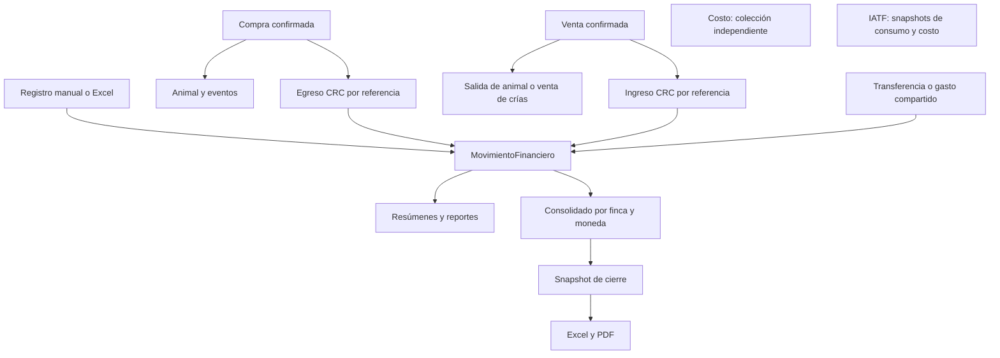

# Auditoría del módulo de Finanzas y Costos

Fecha: **13 de octubre de 2026**. Base de código: commit `9081d8a`, más el árbol de trabajo existente. Instrucción aplicada: [Agents.md](Agents.md), «Auditoría exhaustiva del módulo de finanzas y costos».

## 1. Resumen Ejecutivo

La aplicación tiene un registro financiero operativo con ingresos y egresos, compras, planilla e inversiones; integración automática con compras y ventas de animales; catálogos editables; reportes de productos y economía ganadera; transferencias y gastos compartidos entre fincas; consolidación Premium, metas y cierres exportables. Estas capacidades tienen implementación real. No se encontraron pantallas financieras alimentadas únicamente con datos simulados.

Su madurez es **básica en contabilidad y desigual en analítica económica**. El registro de operaciones está desarrollado, pero algunos cálculos y controles impiden tratar sus resultados como estados financieros conciliados. Los problemas prioritarios son:

- Los endpoints de escritura aceptan campos de organización, finca, origen y consolidación enviados por el cliente. El aislamiento de consultas no corrige esos campos al crear documentos.
- Los movimientos generados por compras, ventas y operaciones multi-finca pueden editarse o eliminarse desde el CRUD financiero sin actualizar su origen.
- La modificación de una compra puede borrar y recrear animales, dejando referencias históricas sin su animal original. Las operaciones ganaderas y financieras no forman una única transacción.
- Varios resúmenes suman CRC y USD. La consolidación Premium sí separa monedas, pero los resúmenes generales y distintas estimaciones económicas no siguen esa metodología.
- Se reprodujeron errores de doble conteo patrimonial, sobreasignación de costos por camada y pérdida del ajuste de compra en sustentabilidad.
- El rol Contador encuentra dependencias de interfaz que solicitan recursos no autorizados. El resumen financiero por correo tampoco verifica los permisos financieros y de finca del destinatario.

**Alcance y evidencia.** Se inspeccionaron esquemas, rutas, controladores, servicios, permisos, planes, componentes, cliente API y pruebas. `npm.cmd test`, ejecutado en `backend`, completó las **195 pruebas: todas pasaron**. `npm.cmd run build`, ejecutado en `frontend`, terminó correctamente, incluida la generación PWA. Vite advierte de un paquete JavaScript superior a 500 kB. Se ejecutaron además reproducciones aisladas sobre funciones reales y validación Mongoose con datos sintéticos, sin persistencia. No se ejecutaron transacciones contra MongoDB, pruebas de concurrencia ni navegación autenticada en un navegador; las conclusiones sobre esos flujos se basan en el código. Las pruebas existentes no cubren todos los defectos documentados.

### Mapa de arquitectura inspeccionada

| Área | Archivos principales y responsabilidad |
|---|---|
| Registro financiero | [MovimientoFinanciero.js](backend/models/MovimientoFinanciero.js), [finanza.js](backend/routes/finanza.js), [controlador](backend/controllers/movimientoFinanciero-controller.js), [normalización](backend/services/normalizacionFinanciera-service.js). Es la fuente de los reportes monetarios. No se encontró un modelo financiero principal `Finanza.js`. |
| Costos independientes | [Costo.js](backend/models/Costo.js), [rutas](backend/routes/costo.js), [controlador](backend/controllers/costo-controller.js). CRUD separado sin integración encontrada con los resúmenes de movimientos. |
| Catálogos | [CatalogoFinanciero.js](backend/models/CatalogoFinanciero.js), [configuración base](backend/config/catalogosFinancieros.js), [controlador](backend/controllers/catalogoFinanciero-controller.js). Categorías y destinos por organización. |
| Compras y ventas | [CompraAnimal.js](backend/models/CompraAnimal.js), [VentaAnimal.js](backend/models/VentaAnimal.js), [compras](backend/controllers/compraAnimalController.js), [ventas](backend/controllers/ventaAnimalController.js), sus rutas y servicios de lotes, cuota y eventos. |
| Multi-finca | [servicio de operaciones y cierres](backend/services/consolidacionMultiFinca-service.js), [reporte consolidado](backend/services/reporteMultiFinca-service.js), [controlador](backend/controllers/consolidacionMultiFinca-controller.js), [MetaConsolidacion.js](backend/models/MetaConsolidacion.js), [CierreConsolidado.js](backend/models/CierreConsolidado.js), [exportación de cierres](backend/services/cierreConsolidado-export-service.js). |
| Analítica | [rutas de reportes](backend/routes/reporte.js), [controlador de reportes](backend/controllers/reporte-controller.js), [analítica de compras](backend/services/reporteComprasAnimales-service.js). |
| Interfaz operativa | [Finanzas.js](frontend/src/Components/Finanzas.js), [formulario](frontend/src/Components/FormularioMovimientoFinanciero.js), [TablaDinamica.js](frontend/src/Components/TablaDinamica.js), [Compras.js](frontend/src/Components/Compras.js), [Ventas.js](frontend/src/Components/Ventas.js), [operaciones multi-finca](frontend/src/Components/OperacionesFinancierasMultiFinca.js). |
| Interfaz analítica | [Reportes.js](frontend/src/Components/Reportes.js), [ReporteComprasAnimales.js](frontend/src/Components/ReporteComprasAnimales.js), [ReporteMultiFinca.js](frontend/src/Components/ReporteMultiFinca.js), [GestionConsolidacionPremium.js](frontend/src/Components/GestionConsolidacionPremium.js), [cliente API](frontend/src/services/api.js). |
| Acceso y trazabilidad | [planes](backend/config/planes.js), [PlanService](backend/services/plan-service.js), [guards](backend/middleware/plan.js), [roles](backend/config/permisosRoles.js), [autenticación](backend/middleware/auth.js), [aislamiento](backend/models/plugins/organizacion-plugin.js), [auditoría HTTP](backend/middleware/auditoria.js). |
| Satélites | [importación Excel](backend/services/importarExcel-service.js), [controlador de importación](backend/controllers/importar-controller.js), [costeo IATF](backend/services/iatf-service.js), [resúmenes por correo](backend/services/resumenEmail-service.js), [facturación SaaS](backend/controllers/facturacion-controller.js). |

## 2. Catálogo Detallado de Funcionalidades Activas

**Criterio de madurez:** «100% Funcional» identifica una capacidad acotada con implementación completa encontrada en backend e interfaz, dentro de lo descrito; no certifica ausencia de defectos ni operación en producción. «Básico» identifica implementación parcial, manual, estimativa o afectada por limitaciones materiales. «Mock» se reservaría para simulaciones; no se identificaron en este alcance. Los hallazgos transversales de la sección 5 aplican aunque una función individual esté completa.

| Submódulo / Función | Descripción de lo que hace | Estado en Backend | Estado en Frontend | Nivel de Madurez (100% Funcional / Básico / Mock) |
|---|---|---|---|---|
| Movimientos / registro | Registra fecha, tipo, naturaleza, categoría, descripción, importe y moneda. | Crear, listar, editar y eliminar documentos reales. | Formulario y tabla con acciones. | Básico |
| Movimientos / ingresos y egresos | Distingue `Ingreso` y `Egreso`; monto no negativo. | Ambas naturalezas para cualquier tipo admitido. | Selector de naturaleza; tipos manuales Compra, Planilla e Inversion. | Básico |
| Movimientos / metadatos | Método de pago, proveedor, empleado, producto, cantidad, unidad, precio, destino, observaciones y texto de finca. | Campos opcionales persistidos. | Campos según tipo de movimiento. Sin adjunto de comprobante. | Básico |
| Movimientos / monedas | Admite CRC y USD sin conversión cambiaria. | Moneda por documento; agregaciones inconsistentes. | Selector y ciertos totales separados; otros se presentan como CRC. | Básico |
| Movimientos / filtros y tabla | Fechas, tipo y filtros de columnas; orden y paginación visual. | Listado general completo, sin paginación ni filtro de período en servidor. | Filtrado local; filtros adicionales de tabla no recalculan todas las tarjetas. | Básico |
| Movimientos / resúmenes | Totales por tipo, naturaleza, categoría, mes y moneda; balance. | `/resumen`, sin filtro temporal ni separación de moneda en la mayoría de grupos. | Tarjetas generales y subtotales visibles. | Básico |
| Movimientos / revisión de calidad | Cuenta campos faltantes y categorías genéricas; devuelve ejemplos. | `/revision-datos`; reglas de completitud. | Panel equivalente calculado sobre registros cargados. | Básico |
| Catálogos / categorías y destinos | Alta, renombre, activación, desactivación y eliminación; uso en movimientos. | Catálogo por organización, semilla inicial y control de nombre/uso. | Editor administrativo integrado. | Básico |
| Catálogos / opciones complementarias | Tipos, monedas, unidades, pagos, trabajos e inversiones. | Listas base; no CRUD de todas ellas. | Selectores/datalists y valores históricos. | Básico |
| Catálogos / propagación histórica | Renombrar puede actualizar movimientos existentes. | Actualización masiva organizacional, opcional. | Confirmación específica de propagación. | Básico |
| Consumo / productos comprados | Cantidad física e importe por producto, unidad y categoría. | Filtra compras que son egresos; no descuenta inventario. | Resumen de productos y reportes. | Básico |
| Consumo / normalización | Interpreta presentaciones como `46 KG` o `46 x KG`. | Calcula cantidad física y precio físico; alias de unidad. | Muestra valores normalizados. | Básico |
| Planilla / captura | Período, trabajo, personas, días, horas, costo unitario y empleado. | Datos opcionales dentro del movimiento. | Formulario específico. | Básico |
| Planilla / resumen | Suma importes, personas, días y horas; agrupa por trabajo, empleado y mes. | `/planilla-resumen`; sin motor salarial. | Tarjetas y tabla de movimientos. | Básico |
| Inversiones / captura | Tipo, activo, destino, estado, vida útil, inicio de uso y residual. | Campos dentro del movimiento, sin registro independiente de activo. | Formulario específico. | Básico |
| Inversiones / depreciación | Guarda depreciación mensual y condición depreciable. | Suma valores declarados; no calcula ni contabiliza cuotas. | Entrada manual y resumen. | Básico |
| Destinos / imputación | Clasifica gastos y otros movimientos por destino. | Resumen por destino y moneda; `animal` y `potrero` son referencias opcionales. | Destino seleccionable; no selector estructurado de animal/potrero en este formulario. | Básico |
| Costos / CRUD independiente | Registra categoría, monto, proveedor, fecha y notas. | `/api/costos` con CRUD; modelo sin moneda. | No se encontró pantalla ni consumo del endpoint. | Básico |
| Compras / documento | Proveedor, contactos, fecha, especie, líneas individuales y ajuste final. | Validación, subtotales, totales, estados y CRUD. | Captura, consulta, edición y anulación. | Básico |
| Compras / alta animal y lote | Crea animales comprados, registra origen y permite lote rápido/asignación. | Control de cuota, objetivos productivos, eventos y pertenencias. | Captura grupal y flujo de lote. | Básico |
| Compras / egreso automático | Una compra confirmada genera movimiento ligado a su documento. | Upsert por referencia `CompraAnimal`, moneda CRC. | Visible en Finanzas; sin protección contra edición separada. | Básico |
| Compras / resumen | Compras confirmadas, animales, kilos, montos y precio ponderado por kg. | Filtros de fecha/especie; listado también por proveedor/estado. | Indicadores y listado. | Básico |
| Ventas / individuales | Vende animales con peso y precio/kg, comprador y ajuste total. | Validaciones de elegibilidad/especie y totales. | Selección, cálculo previo, guardado y consulta. | Básico |
| Ventas / por camada | Vende cantidad de crías y peso total sin individualizarlas artificialmente. | Control de disponibilidad; las ventas no anuladas afectan reserva disponible. | Flujo porcino con selección de camada. | Básico |
| Ventas / ingreso y salida | Venta confirmada actualiza animal, pertenencia y eventos; genera ingreso. | Movimiento por referencia `VentaAnimal`, CRC; montos distribuidos. | Reflejo en inventario y Finanzas. | Básico |
| Compras y ventas / reversión | Edita, anula o elimina con reversión de efectos. | Borrado/recreación de efectos; ventas tienen compensación ante algunos fallos. | Acciones según rol y estado. | Básico |
| Ventas / resumen | Totales, kilos, precio ponderado, compradores, categorías y evolución. | Datos reales; algunos análisis adicionales dependen de plan. | Resumen y filtros. | Básico |
| Multi-finca / transferencia | Registra salida y entrada relacionadas entre dos fincas autorizadas. | Dos movimientos en transacción MongoDB, excluidos del resultado externo consolidado. | Formulario de origen/destino, importe y moneda. | Básico |
| Multi-finca / gasto compartido | Distribuye un gasto por partes iguales, porcentajes o importes. | Validación de distribución y transacción para las participaciones. | Selección de fincas y modalidad de reparto. | Básico |
| Multi-finca / historial | Consulta movimientos de transferencias y gastos compartidos. | Filtro de fechas y fincas autorizadas; límite de registros. | Lista reciente con paginación local; sin reversión grupal. | Básico |
| Reportes / panorama financiero | Ingresos, egresos, categorías, tipos y evolución mensual del período. | Integrado en `/reportes/resumen`. | Tarjetas, tablas y gráficos reales. | Básico |
| Reportes / productos | Resumen, detalle por producto, categoría, combustibles, precios, proveedores, destinos y top. | Ocho endpoints; detalle de producto paginado en base. | Filtros, gráficos y tablas en Reportes. | Básico |
| Reportes / finanzas de cría | Inversión acumulada, gasto operativo, ingresos, hato y patrimonio estimado. | Fórmulas implementadas con doble conteo y límites de período/especie. | Panel económico. | Básico |
| Reportes / sustentabilidad | Estima costo mensual por animal y margen de animales vendidos. | Prorrateo estimativo; metodología y ajuste de compra inconsistentes. | Indicadores y detalle por animal. | Básico |
| Reportes / compras ganaderas | Inversión, precio efectivo/kg, proveedores, razas, sexo, evolución, margen bruto y seguimiento productivo. | Servicio específico con prorrateo del monto final y pruebas. | Panel y gráficos; filtros y detalle. | Básico |
| Reportes / economía de camadas | Ingresos, egresos, balance, estimación por camada y por cría. | Asociación directa o por textos; reparto defectuoso en escenarios mixtos. | Panel porcino y tabla de camadas. | Básico |
| Premium / consolidado | Compara fincas y consolida ingresos, egresos, balance y gasto compartido. | Separa CRC/USD y elimina transferencias del resultado externo. | Tabla comparativa, indicadores y evolución. | Básico |
| Premium / detalle | Abre los movimientos que sustentan la métrica de una finca. | Consulta de detalle limitada a 200 registros. | Panel de desglose. | Básico |
| Premium / metas | Objetivos de ingreso, egreso máximo y balance, además de metas productivas. | Organización/finca y período; importes sin campo de moneda. | Crear, listar, comparar y eliminar según permisos; etiquetas monetarias CRC. | Básico |
| Premium / cierres | Conserva snapshot del reporte, período, fincas y autor; evita duplicado de la misma clave. | Crear/listar/consultar; sin API de edición. No bloquea movimientos del período. | Historial y detalle del cierre. | Básico |
| Premium / exportar consolidado vigente | Libro Excel con resumen, fincas, monedas, evolución y metas. | Generación XLSX real. | Descarga desde consolidación. | 100% Funcional |
| Premium / exportar cierre guardado | Exporta los datos persistidos del cierre, sin recalcularlos con datos actuales. | XLSX y PDF; pruebas específicas de snapshot y contenido. | Botones de ambas descargas en el detalle. | 100% Funcional |
| Importación / hoja FINANZAS | Plantilla Excel, previsualización, validación, confirmación y resultados. | Crea movimientos; valida catálogos y bloquea ciertos archivos repetidos. | Flujo general de importación. Sin deduplicación financiera por registro. | Básico |
| Auditoría / modificaciones | Guarda actor, ruta, método, cuerpo sanitizado y resultado HTTP. | Middleware global para escrituras; registro asíncrono. | Consulta avanzada para Administrador en PRO/PREMIUM. | Básico |
| Notificaciones / finanzas | Informa creación, modificación y eliminación de movimiento. | Servicio de notificaciones asociado al CRUD. | Centro de notificaciones existente. | Básico |
| Correos / resumen financiero | Resume ingresos, egresos y balance diario o semanal. | Recopila por organización y envía según configuración Premium; problemas de autorización y moneda. | Preferencias de correo. | Básico |
| IATF / costeo productivo | Snapshots de productos usados, semen y costos adicionales; costo/preñez cuando calculable. | Costos por moneda; total global nulo si mezcla monedas. No crea egreso por consumo. | Métricas de campaña; consolidación adicional Premium. | Básico |
| Facturación SaaS / suscripción | Estado de facturación, checkout, portal y webhook Stripe de la suscripción. | Flujo separado del dinero de la finca; depende de configuración externa. | Gestión del plan. No factura ventas ganaderas. | Básico |

### Superficie API financiera

Las rutas están montadas con autenticación en [app.js](backend/app.js). Se distinguen operaciones básicas de las protegidas por capacidad de plan.

| Prefijo | Rutas relevantes |
|---|---|
| `/api/finanzas` | `GET/POST /`, `PUT/DELETE /:id`, `GET /tipo/:tipoMovimiento`, `/resumen`, `/consumo`, `/planilla-resumen`, `/inversiones-resumen`, `/destinos-resumen`, `/revision-datos`. |
| `/api/finanzas/catalogos` | `GET/POST /`, `GET /admin`, `PUT/DELETE /:id`, `PATCH /:id/activar`, `PATCH /:id/desactivar`. |
| `/api/finanzas/multi-finca` | `GET /`, `POST /transferencias`, `POST /gastos-compartidos`. |
| `/api/costos` | `GET/POST /`, `GET/PUT/DELETE /:id`. |
| `/api/compras` | `GET/POST /`, `GET /resumen`, `GET/PUT/DELETE /:id`, `PATCH /:id/anular`, `POST /:id/asignar-lote`. |
| `/api/ventas` | `GET/POST /`, `GET /resumen`, `GET/PUT/DELETE /:id`, `PATCH /:id/anular`. |
| `/api/reportes` | `GET /resumen`, `/finanzas-cria`, `/sustentabilidad-cria`, `/compras-animales`, `/porcinos/economia-camadas`. |
| `/api/reportes/productos` | `GET /resumen`, `/por-producto`, `/por-categoria`, `/combustibles`, `/precio-promedio`, `/proveedores`, `/destinos`, `/top`. |
| `/api/reportes/multi-finca` | `GET /`, `/exportar`, `/detalle`; `GET/POST /metas`, `DELETE /metas/:id`; `GET/POST /cierres`, `GET /cierres/:id`, `GET /cierres/:id/exportar`. |

## 3. Flujos de Datos y Cálculos Automáticos

### 3.1 Registro, clasificación y fuentes de verdad

`MovimientoFinanciero` contiene la clasificación económica. `organizacionId` y `fincaId` delimitan el ámbito real; el campo `finca` es texto descriptivo. `referenciaModelo`/`referenciaId` conectan con el origen; `grupoConsolidacion`, `fincaContraparte`, `alcanceFinanciero` y `excluirConsolidacion` describen operaciones entre fincas.

Las categorías y destinos son etiquetas, sin plan de cuentas jerárquico, subcuentas, partida doble ni centro de costo estructurado por lote. `animal` y `potrero` permiten una referencia opcional mediante API, pero el formulario financiero no las ofrece. `activoAsociado`, proveedor y empleado también son textos, no auxiliares contables con saldo propio. No existe comprobante adjunto en el esquema actual.

El CRUD `Costo` guarda una segunda colección de datos. No se encontraron lecturas de esa colección en los reportes financieros revisados ni sincronización con movimientos. Registrar allí un costo no incrementa automáticamente los egresos mostrados en Finanzas.

### 3.2 Movimientos y productos

- `balance = suma(Ingreso) - suma(Egreso)`; `totalGeneral = suma(monto)` sin signo. El segundo expresa volumen registrado, no saldo ni utilidad.
- `cantidadFisica = cantidad × factorUnidad`. Por ejemplo, 40 unidades de `46 KG` representan 1.840 KG.
- `precioUnitarioFisico = monto / cantidadFisica`, con monto y cantidad positivos. El normalizador no calcula `monto = cantidad × precioUnitario`.
- Los reportes de consumo consideran `tipoMovimiento = Compra`, `naturaleza = Egreso`, producto informado y cantidad positiva. Compras de animales y ventas quedan fuera.
- El precio agregado ponderado usa importe total dividido por cantidad física de su grupo. Solo es interpretable si los importes comparten moneda y las cantidades comparten unidad compatible.
- Se normalizan alias y presentaciones, pero no existe una conversión general KG↔G o L↔ML, ni un peso implícito para todo saco. Los productos se identifican por texto.

**Límite semántico:** estos reportes muestran compras declaradas de insumos. No prueban consumo real de alimento o medicamento, no son kardex y no se alimentan automáticamente de `SuministroAlimentacion`. El rótulo «consumo» debe expresar esa limitación.

### 3.3 Planilla e inversiones

La planilla agrega los montos declarados y los campos de personas/días/horas. Una persona repetida en diez movimientos puede contarse diez veces en la suma de `cantidadPersonas`; no es una plantilla de empleados únicos. No se detectó cálculo salarial, deducciones, cargas, vacaciones, liquidación, comprobante de pago o relación validada entre horas y monto.

Inversiones suma monto, valor residual y depreciación mensual declarada; agrupa por tipo y estado. `depreciacionMensual` es una entrada, no el resultado automático de `(costo - residual) / vidaUtilMeses`. No se generan asientos mensuales, bajas, valor neto o calendario de depreciación.

### 3.4 Compras de animales

1. Valida animales y objetivos productivos; guarda el documento. Si queda confirmado, crea animales con control de cuota y eventos, puede asignarlos a lote y genera el egreso financiero.
2. Por línea: `subtotal = pesoCompraKg × precioKg`. `montoCalculado = suma(subtotales)`; `montoTotal = montoFinal` cuando se informa un número válido, o el calculado. `ajusteMonto = montoTotal - montoCalculado`.
3. El costo asignado pretende distribuir `montoTotal × subtotal / montoCalculado`. La creación del animal conserva además `precioCompraPorKg = precioKg` original. Para `montoTotal = 0`, su condición por valor verdadero vuelve al subtotal original: defecto documentado en F07.
4. El movimiento se actualiza/inserta por `referenciaModelo = CompraAnimal` y referencia de compra, como egreso CRC. El índice de referencia no es único.
5. Editar primero revierte la compra: borra animales activos asociados, movimiento y eventos de compra; después actualiza y reaplica. Se impide revertir si hay historial de lote o animales vendidos/muertos, pero no se comprueba todo el historial de pesajes, reproducción o sanidad.

El [reporte específico de compras](backend/services/reporteComprasAnimales-service.js) calcula el costo efectivo desde el documento y sí prorratea su monto final. Su `margenBruto = montoVenta - costoAsignadoCompra` excluye gasto operativo, alimentación, sanidad y financiación: no es rentabilidad neta.

### 3.5 Ventas de animales y crías

Las líneas individuales calculan `pesoVentaKg × precioKg`; las de camada usan `pesoTotalKg × precioKg`. El número de animales es la cantidad de líneas individuales más las crías vendidas por camada. El ajuste final se distribuye en los importes efectivos de venta.

Una venta confirmada actualiza el animal a `Vendido`, guarda fecha, peso, precio efectivo e importe, cierra pertenencias y registra eventos. Genera un ingreso CRC por referencia `VentaAnimal`. Las ventas por camada conservan su unidad de dominio, sin crear animales artificiales.

La reversión restaura datos del animal y elimina movimientos/eventos referenciados. La actualización incorpora compensación si falla la reaplicación y existen controles de cuota para reactivación. Esto mejora el flujo, pero no lo convierte en una transacción integral: puede fallar la compensación y el cierre previo de pertenencias no se restituye desde `revertirVenta`.

Las compras y ventas no tienen moneda propia seleccionable: sus movimientos automáticos son CRC. Sus estados documentales no representan cuentas por cobrar/pagar; una venta confirmada no demuestra que el dinero fue cobrado. El método «Crédito» en un movimiento es una etiqueta, sin saldo pendiente ni vencimiento.

### 3.6 Multi-finca y cierres

**Transferencia:** valida importe positivo y fincas distintas autorizadas. En una transacción crea un egreso de origen y un ingreso de destino, con el mismo grupo, importe y moneda. Ambos llevan `excluirConsolidacion = true`. Es un registro interno; no ejecuta una transferencia bancaria ni verifica un saldo de banco.

**Gasto compartido:** crea un egreso por participación, sin agregar además otro egreso maestro. Permite `IGUAL`, `PORCENTAJE` o `MONTO`; controla duplicación de fincas y suma de distribución. En reparto calculado redondea a dos decimales y entrega el residuo a la última participación. Los egresos conservan grupo común y entran en el consolidado una vez por su porción. No hay idempotencia de petición ni anulación coordinada desde la interfaz.

**Consolidado:** agrupa por finca y moneda; suma ingresos/egresos externos y calcula balances por moneda. Mantiene transferencias separadas y el gasto compartido distribuido. Los campos históricos de importe simples corresponden a CRC; el objeto `monedas` contiene CRC/USD. No realiza conversión. El filtro de especie del reporte no desagrega financieramente movimientos que carecen de especie.

**Metas:** compara valores por período y finca/organización. La interfaz etiqueta los importes como CRC, y no hay moneda en el esquema de meta; no permite presupuestar CRC y USD de manera independiente.

**Cierres:** conservan los datos del reporte bajo una clave por rango, especie y fincas ordenadas. Se impide crear otra vez la misma clave. La API no ofrece edición del snapshot y la exportación de cierre usa los datos guardados. El cierre no bloquea registrar, editar, borrar ni recategorizar movimientos anteriores: el reporte vivo puede diferir del cierre sin una conciliación automática de cambios.

### 3.7 Analítica económica: metodología efectivamente implementada

| Indicador | Fórmula o criterio actual | Límite relevante |
|---|---|---|
| Inversión acumulada de cría | Egresos históricos de tipo Inversion/Compra de animales o categorías Ganado, Infraestructura, Maquinaria, Compra de animales. | No está limitada al cierre del período solicitado; clasificación por etiquetas editables. |
| Gasto operativo | Egresos Compra/Planilla excluyendo lo clasificado como inversión. | No incluye la colección Costo ni todos los costos productivos posibles. |
| Balance operativo | Ingresos del período menos gasto operativo. | No equivale al balance general, que también resta compras de animales e inversiones; además puede incluir transferencias entrantes. |
| Valor del hato | Para animales actualmente activos: valor estimado, o monto de compra, o peso actual por precio estimado disponible. | Usa valores verdaderos como fallback; ausencia de valor termina en cero. No es valoración histórica a la fecha de corte. |
| Patrimonio estimado | Valor del hato más inversión acumulada. | Duplica adquisición del ganado si ya está valorado a costo; tampoco deduce pasivos/depreciación. |
| Costo mensual por animal | Gasto operativo del período / animales considerados activos en período / meses del período. | Recuento sin ponderar días de permanencia; excluye actualmente muertos incluso en períodos anteriores. |
| Costo asignado a vendido | Costo mensual anterior × meses completos entre ingreso y venta. | Extrapola el costo de la ventana consultada a toda la permanencia; no usa costos históricos individuales. |
| Margen de sustentabilidad | Venta por kg menos compra por kg menos costo asignado. | Prioriza precio/kg original de compra sobre monto ajustado; solo animales individuales vendidos con peso/precio positivos. |
| Patrimonio y sustentabilidad por especie | Consultan `Animal.find()` en la finca. | No aplican el filtro de especie recibido por la página. |
| Precio medio ganadero | Monto total / kilos totales. | Ponderado por kg; no promedio simple de precios de línea. |
| Economía de camadas | Movimientos ligados por referencia a camadas más los identificados por textos porcinos, deduplicados por ID. | No es imputación exhaustiva; las ventas referencian VentaAnimal, no cada camada. |
| Estimación por camada | Usa gasto/ingreso directo si es distinto de cero; si no, total del conjunto / cantidad de camadas. | Puede sobreasignar o perder importes; un cero directo se interpreta como ausencia. |
| Costo por cría | Importe / máximo entre número de crías y 1. | Con cero crías devuelve importe, en vez de indicador no calculable. |
| Costos IATF | Productos realmente aplicados + semen utilizado + costos adicionales, agrupados por moneda. | Depende de costos configurados; no demuestra desembolso financiero. Sin total único si hay monedas mezcladas. |

No se encontró un cálculo financiero integral por lote, por hectárea, por ración suministrada o por ciclo de engorde/banda porcina. Las funcionalidades operativas de esos dominios no sustituyen la falta de una metodología de imputación económica. No se detectó generación de un segundo egreso financiero por consumir insumos IATF: su costeo productivo permanece separado.

## 4. Segmentación por Planes (`ESENCIAL`, `GESTIÓN`, `PRO`, `PREMIUM`)

La matriz refleja [config/planes.js](backend/config/planes.js) y los guards efectivos de rutas. «Sí» siempre requiere además rol y acceso a la finca. Las rutas básicas no tienen una feature financiera exclusiva: no corresponde presentar Esencial como una caja chica limitada ni reservar planilla o inversiones a Gestión.

| Capacidad financiera | ESENCIAL | GESTIÓN | PRO | PREMIUM | Control efectivo |
|---|---|---|---|---|---|
| Movimientos manuales, ingresos/egresos, CRC/USD | Sí | Sí | Sí | Sí | `finanzas.ver/gestionar` |
| Planilla e inversiones básicas | Sí | Sí | Sí | Sí | Mismas rutas de movimientos |
| Catálogos financieros | Sí | Sí | Sí | Sí | `finanzas.administrarCatalogos` |
| Consumo, destinos y revisión de datos | Sí | Sí | Sí | Sí | Finanzas; destinos-resumen exige `reportes.ver` |
| CRUD de Costos por API | Sí | Sí | Sí | Sí | Permisos financieros; sin UI encontrada |
| Compras, ventas y movimientos automáticos | Sí | Sí | Sí | Sí | Permisos de compras/ventas; cuota/especie/lote aplicables |
| Resumen financiero y reportes de productos | Sí | Sí | Sí | Sí | `reportes.ver`, sin guard `analiticaEconomica` en productos |
| Importación financiera Excel | Sí | Sí | Sí | Sí | Administrador; flujo general de importación |
| Transferencias y gastos compartidos | No | Sí | Sí | Sí | `requireFeature('operacionMultiFinca')` + permisos financieros |
| Finanzas de cría y sustentabilidad | No | No | Sí | Sí | `requireFeature('analiticaEconomica')` |
| Economía de camadas y analítica de compras | No | No | Sí | Sí | `requireFeature('analiticaEconomica')` |
| Costeo productivo IATF | No | No | Sí | Sí | `iatfReproductivo` y permisos reproductivos |
| Consulta de auditoría avanzada | No | No | Sí | Sí | `auditoriaAvanzada` + Administrador |
| Consolidado, comparaciones y desglose multi-finca | No | No | No | Sí | `reportesMultiFinca` + `reportes.ver` |
| Metas, cierres y exportaciones consolidadas | No | No | No | Sí | `reportesMultiFinca`; escribir metas/cierres exige `reportes.configurar` |
| Resúmenes financieros configurables por correo | No | No | No | Sí | `configuracionEmailAvanzada`; el job también filtra Premium |
| Número máximo configurado de fincas | 1 | 2 | 5 | 10 | Límites del plan |

`PlanService` y `requireFeature` resuelven capacidades y vigencia para las funciones protegidas; no se detectó que los reportes económicos avanzados estén habilitados por una simple comparación de nombre de plan. En cambio, el job de resúmenes por correo contiene un filtro directo `plan.codigo = PREMIUM`. Las rutas financieras básicas no agregan un guard de vigencia propio; autenticación comprueba organización activa. Conviene definir explícitamente su política de lectura/escritura cuando vence una suscripción.

### Roles que modifican el acceso real

| Función | Roles definidos |
|---|---|
| Ver y modificar Finanzas; CRUD de Costos; operar finanzas multi-finca | Administrador, Contador |
| Administrar catálogos | Administrador |
| Ver compras y ventas | Administrador, Encargado, Contador, Consulta |
| Crear, editar y anular compras/ventas | Administrador, Encargado |
| Eliminar compras/ventas | Administrador |
| Ver reportes, incluidos económicos si el plan lo permite | Administrador, Contador, Consulta |
| Crear/eliminar metas y crear cierres | Administrador |
| Consultar auditoría avanzada | Administrador |

Por diseño de permisos, Consulta puede ver reportes monetarios aunque no entre a Finanzas; debe confirmarse que esa exposición sea la intención comercial. Contador puede modificar el movimiento generado por una compra/venta pese a no poder modificar su documento de origen: F02. Los errores de carga descritos en F10 impiden que la matriz de acceso a compras/ventas se cumpla completamente en interfaz.

## 5. Oportunidades de Mejora / Funcionalidades Faltantes

Prioridades: **P1** afecta autorización, integridad o resultados monetarios; **P2** afecta precisión, operación y trazabilidad; **P3** corresponde a ampliaciones. Las recomendaciones son acciones propuestas; esta entrega es una auditoría y no cambia código de negocio.

### F01 — P1: campos de organización, finca y control financiero aceptados desde el cliente

**Evidencia:** [creación de movimiento](backend/controllers/movimientoFinanciero-controller.js#L113), [actualización](backend/controllers/movimientoFinanciero-controller.js#L634), [CRUD de costos](backend/controllers/costo-controller.js), [plugin de aislamiento](backend/models/plugins/organizacion-plugin.js). Los controladores pasan el cuerpo al modelo; la normalización conserva campos adicionales. El plugin agrega filtros de lectura, pero en validación solo asigna organización/finca si faltan, y una actualización normal no inmoviliza esos campos.

**Reproducción aislada:** bajo contexto organización A/finca A, `new MovimientoFinanciero({...camposValidos, organizacionId: B, fincaId: B, excluirConsolidacion: true}).validate()` terminó sin error y conservó B/B y el indicador. No se persistió el documento ni se intentó acceso real a otra organización.

**Impacto:** un usuario con permiso de escritura puede intentar inyectar o trasladar documentos a otro ámbito conocido y manipular inclusión/origen/grupo. No demuestra lectura arbitraria, pero sí ausencia de validación de ámbito en la entrada. **Corrección:** DTOs permitidos; organización y finca impuestas desde contexto; campos internos inmutables para el CRUD manual; validación contextual de referencias. Extender la revisión a compras/ventas que también construyen documentos con `...req.body`.

### F02 — P1: edición independiente de movimientos automáticos rompe la fuente de verdad

**Evidencia:** [update/delete de Finanzas](backend/controllers/movimientoFinanciero-controller.js#L634) no comprueban `referenciaModelo`, grupo o alcance. La [tabla financiera](frontend/src/Components/Finanzas.js) ofrece las acciones sobre movimientos cargados, incluidos los generados.

**Escenario:** confirmar una venta por 100 y cambiar su movimiento a 80 deja venta/animal en 100 e ingreso en 80; eliminar una pata de transferencia deja su contraparte intacta. Contador puede hacerlo sin permiso para modificar la venta. **Corrección:** movimientos derivados de solo lectura en CRUD manual; correcciones por el dominio de origen; reversión transaccional del grupo y conciliación periódica origen↔movimiento. Un índice único condicionado para referencias automáticas y una clave de idempotencia reducirían duplicados.

### F03 — P1: una compra editable puede destruir la identidad e historial del animal

**Evidencia:** [reversibilidad y borrado](backend/controllers/compraAnimalController.js#L270), [edición](backend/controllers/compraAnimalController.js#L366), [normalización de formulario](frontend/src/Components/Compras.js#L86). El formulario omite el ID del animal, la reversión elimina animales activos y la reaplicación crea otros. Los bloqueos revisan pertenencias y estado Vendido/Muerto, no todas las referencias.

**Escenario:** animal comprado, activo, sin historial de lote, con un pesaje o registro reproductivo; editar el proveedor de la compra puede recrearlo con otro ID y dejar sus datos históricos asociados al anterior. **Corrección:** conservar IDs y actualizar datos permitidos; impedir eliminar animales con dependencias; separar anulación comercial del inventario histórico. Validar integridad con fixtures de pesajes, sanidad y reproducción.

### F04 — P1: compras/ventas no tienen atomicidad integral

**Evidencia:** [crear compra](backend/controllers/compraAnimalController.js#L334) y [crear venta](backend/controllers/ventaAnimalController.js#L373) guardan documento antes de aplicar todos los efectos. No envuelven documento, animal, movimiento, pertenencia y eventos en una sesión común. [Actualizar venta](backend/controllers/ventaAnimalController.js#L405) incluye compensación explícita, que también puede fallar; [revertir venta](backend/controllers/ventaAnimalController.js#L295) no reabre pertenencias cerradas.

**Impacto:** ante error posterior al guardado puede quedar una operación confirmada parcialmente aplicada. La anulación de venta puede dejar un animal activo sin restaurar su situación de lote. No se simuló fallo de base ni carrera concurrente. **Corrección:** transacciones y validación previa, reserva atómica de animales/crías, idempotencia, y política explícita de restauración de pertenencias. Aprovechar la infraestructura transaccional ya usada en operaciones multi-finca.

### F05 — P1: mezcla de monedas en balances, precios y estimaciones

**Evidencia:** [resumen general](backend/controllers/movimientoFinanciero-controller.js#L133), resúmenes de consumo/planilla/inversiones del mismo controlador, [reportes de cría](backend/controllers/reporte-controller.js#L685), productos, economía de camadas y [correo](backend/services/resumenEmail-service.js#L51). Agrupan montos sin moneda. La interfaz suele aplicar formato CRC.

**Ejemplo aritmético:** egresos de 1.000 CRC y 100 USD producen 1.100 en esas sumas. El precio físico de un producto comprado en ambas monedas también queda sin significado monetario único. `totalPorMoneda` no corrige las otras agregaciones. **Corrección:** moneda en claves de agrupación, balances y denominadores; bloquear totales globales incompatibles o incorporar una política explícita de conversión. Reutilizar el patrón por moneda del consolidado y de IATF.

### F06 — P1: patrimonio estimado cuenta dos veces una misma compra

**Evidencia:** [getFinanzasCria](backend/controllers/reporte-controller.js#L685) suma `valorEstimadoHato + inversionAcumulada`; la compra de animales forma parte de ambos.

**Reproducción:** un animal activo con `montoCompra = 100` y su egreso de compra de 100 devolvió hato 100, inversión 100 y patrimonio 200. Se llamó al controlador real con consultas sustituidas por fixtures. **Corrección:** definir valoración de activos y evitar sumar nuevamente su costo de adquisición; distinguir inversión histórica, valor actual y patrimonio. No etiquetar flujo acumulado como patrimonio.

### F07 — P1: sustentabilidad pierde el ajuste del precio de compra

**Evidencia:** [calcularTotalCompraAnimal](backend/controllers/reporte-controller.js#L463) prioriza peso × precio original sobre `montoCompra`; [alta desde compra](backend/controllers/compraAnimalController.js#L136) conserva precio original y monto prorrateado. El [reporte específico de compras](backend/services/reporteComprasAnimales-service.js#L138) usa monto final prorrateado, produciendo otra metodología.

**Reproducción:** compra de 10 kg a 10, ajustada a 80, arroja costo 100 en la función real de sustentabilidad. **Caso adicional por inspección:** monto final cero aceptado por el documento cae al subtotal original en `montoAsignado` por usar condición booleana sobre `montoTotal`. **Corrección:** única función de asignación del importe efectivo, preservando el cero válido; tests de descuento, recargo, cero y varias líneas.

### F08 — P1: economía de camadas no conserva el total asignado

**Evidencia:** [getReporteEconomicoCamadas](backend/controllers/reporte-controller.js#L1976) calcula promedio sobre todo el gasto y después usa `egresosDirectos || egresoProrrateado` para cada camada.

**Reproducción:** dos camadas, un único egreso directo de 100 para A y ninguno para B: resumen 100, detalle A=100 y B=50, suma 150. Se ejecutó el controlador real con fixtures y se verificaron ambos resultados. Con costos generales y directos simultáneos también puede dejar importes sin asignar. **Corrección:** separar fondo directo e indirecto, distribuir solo el indirecto mediante criterio explícito y exigir `suma(asignaciones) = totalAsignable`. Usar referencias estructuradas desde ventas/aplicaciones y devolver no calculable cuando el denominador sea cero.

### F09 — P1: resumen por correo omite autorización financiera y acceso por finca

**Evidencia:** [rutas de configuración](backend/routes/configuracionEmailRoutes.js) exigen la feature Premium, sin permiso de Finanzas; [controlador](backend/controllers/configuracionEmail-controller.js) permite activar `modulos.finanzas`; [recopilación/envío](backend/services/resumenEmail-service.js#L41) consulta toda la organización con `omitirAislamientoFinca`, sin resolver las fincas ni el rol del destinatario. La selección del usuario para envío comprueba estado activo, no permiso financiero de membresía.

**Impacto por inspección:** un miembro Premium sin acceso financiero puede solicitar el resumen; un miembro restringido a una finca puede recibir totales de otras. No se envió ningún correo durante la auditoría. **Corrección:** verificar membresía, permiso actual y fincas accesibles al guardar preferencias y al enviar; aplicar ese ámbito a cada consulta. Separar además monedas y usar capacidades de plan en el job.

### F10 — P2: Contador tiene permisos de lectura que la interfaz no logra utilizar

**Evidencia:** [carga de Compras](frontend/src/Components/Compras.js#L139) solicita lotes y [carga de Ventas](frontend/src/Components/Ventas.js#L116) solicita inventario/camadas dentro de `Promise.all`, incluso en modo lectura. [Permisos](backend/config/permisosRoles.js) permiten compras/ventas a Contador, pero no `lotes.ver`, `inventario.ver` ni `camadas.ver`.

**Consecuencia:** una respuesta 403 de esas dependencias rechaza la carga completa. El botón de catálogos tampoco se oculta por rol en Finanzas aunque su endpoint sea solo Administrador. **Corrección:** solicitar catálogos de selección únicamente al editar con permiso, separar consultas opcionales, y alinear visibilidad de acciones. Verificar con sesiones Contador/Consulta/Encargado, no solo Administrador.

### F11 — P2: tarjetas, filtros, período y especie no representan el mismo conjunto

**Evidencia:** [Finanzas](frontend/src/Components/Finanzas.js) carga resúmenes sin fechas y aplica período/tipo localmente al listado. Los filtros internos de TablaDinamica no llegan a los totales de registros visibles. Compras/ventas filtran documentos por proveedor/comprador/estado, pero sus resúmenes no reproducen todos esos criterios. Los dos reportes de cría consultan animales sin especie.

**Impacto:** la tarjeta, tabla y reporte pueden mostrar cifras válidas para conjuntos diferentes sin distinguirlo suficientemente. **Corrección:** contrato de filtros compartido y metadatos de ámbito; agregar subtotales sobre el mismo conjunto filtrado; etiqueta explícita cuando la cifra sea histórica o de toda la finca. Diferenciar balance operativo, resultado externo y flujo por transferencias.

### F12 — P2: metodología estimativa de sustentabilidad y períodos históricos

El costo mensual del período se multiplica por toda la permanencia del animal; el recuento no usa animal-días y omite muertos actuales. El inicio del hato se reconstruye desde animales activos hoy y `createdAt`, no desde eventos de entrada/salida. El patrimonio usa inversión de toda la historia aunque el reporte pida un período antiguo. La cifra `animalesCompradosPeriodo` en sustentabilidad cuenta vendidos analizados de origen comprado, no todas las compras realizadas en la ventana.

**Corrección:** definir cohortes, fechas de corte y período de imputación; preservar estimación con ese nombre hasta disponer de costos fiables. Unificar metodología entre reportes y mostrar cobertura, animales excluidos y costos no incluidos. Estos problemas no quedan resueltos al corregir exclusivamente F07.

### F13 — P2: escritura parcial, catálogos e importación pueden degradar datos

- El hook de actualización de [MovimientoFinanciero](backend/models/MovimientoFinanciero.js#L102) normaliza únicamente los campos enviados. Actualizar descripción sin categoría puede normalizar categoría a Otros; actualizar monto sin cantidad/unidad no dispone de datos para recalcular precio físico. Fusionar con el registro vigente o construir actualizaciones consistentes.
- Los movimientos aceptan categorías/destinos libres por API, aunque el importador valida catálogos. Renombrar con propagación cambia el histórico de todas las fincas de la organización; no tiene transacción conjunta con el catálogo. El atributo `protegido` no se usa para impedir las operaciones del controlador. Definir política de identidad y versionado de categorías.
- El [controlador de importación](backend/controllers/importar-controller.js#L38) bloquea mismo hash confirmado por el mismo usuario y no permite confirmar de nuevo una previsualización terminada. Sin embargo, [importarFinanzas](backend/services/importarExcel-service.js#L798) siempre crea: otro archivo con las mismas filas, otro usuario o confirmaciones simultáneas pueden duplicar importes. El modo crear/actualizar no ofrece actualización por identidad financiera. Incorporar clave por registro y toma atómica del estado de importación.

### F14 — P2: trazabilidad, cierre y escala operativa incompletos

Los cierres guardan snapshots y **sí tienen exportación XLSX/PDF**, pero no bloqueo de período ni comparación con cambios posteriores. La auditoría HTTP guarda la petición sanitizada, no un antes/después contable completo; se escribe asíncronamente y limita longitud/profundidad. No sustituye un historial inmutable de correcciones.

El listado general descarga todo el histórico, y varios paneles hacen cálculos en memoria. El detalle consolidado limita a 200 y la lista de operaciones multi-finca a 300; paginación visual no recupera los registros omitidos por el servidor. Fuera del consolidado no se encontró exportación general de movimientos, planilla, compras o ventas. **Corrección:** paginación/filtros de servidor, totales asociados al filtro, exportaciones completas, señalización de truncamiento y reversión contable auditable.

### F15 — P3: capacidades financieras no implementadas en este alcance

| Capacidad ausente o parcial | Situación comprobada / siguiente paso posible |
|---|---|
| Conciliación y tesorería | No se encontró banco/cuenta, saldo inicial, extracto conciliable o conciliación de pagos. Los métodos de pago son etiquetas. |
| Cuentas por cobrar/pagar | No hay calendario de vencimientos, abonos, saldo pendiente ni antigüedad de saldos para las ventas/compras revisadas. |
| Contabilidad formal | Sin asientos de partida doble, plan de cuentas jerárquico, balance de comprobación o pasivos estructurados. |
| Comprobantes y facturación ganadera | Sin archivo adjunto en movimiento ni emisión fiscal de venta ganadera encontrada. Stripe administra la suscripción del software. |
| Nómina | Sin motor salarial o liquidaciones; se captura el egreso y sus datos de trabajo. |
| Activos y depreciación | Sin registro de activos conciliado ni cuotas automáticas; valores ingresados manualmente. |
| Costeo de lotes, potreros y alimentación | Referencias parciales y etiquetas; falta distribución verificable por lote/hectárea y valorización fiable del suministro real. |
| Costeo de protocolos | IATF tiene costo productivo; no se encontró costo económico integral de ciclo de engorde/banda porcina. Evitar inferirlo de una tarea programada. |
| Multimoneda integral | Separación parcial; sin tipo de cambio ni fecha de conversión. Metas monetarias presentadas en CRC y documentos ganaderos sin moneda propia seleccionable. |
| Presupuestos | Metas Premium son objetivos agregados, no presupuesto por rubro con compromisos y ejecución. |
| Fuente única de costos | Decidir migración o integración del CRUD Costo para impedir que dos registros de un mismo gasto queden desconectados o se dupliquen. |

### Orden de corrección recomendado y criterios de aceptación

1. **Proteger los datos:** F01, F02, F03 y F09. Rechazar ámbitos ajenos y campos internos; impedir cambios separados de movimientos derivados; conservar IDs de animales; respetar destinatarios y fincas autorizadas en correo.
2. **Asegurar operaciones completas:** F04 y duplicados de F13. Compra/venta/transferencia debe quedar enteramente aplicada o revertida; reintentos no deben duplicar montos ni animales. Probarlo contra MongoDB con transacciones y fallos inducidos.
3. **Corregir cifras:** F05–F08 y F12. Probar moneda única/mixta, compra ajustada/cero, costos directos/indirectos, denominador cero y cortes históricos; cada distribución debe reconciliar con su fuente.
4. **Alinear experiencia y escala:** F10, F11, F14. Verificar permisos en navegador, filtros y totales coherentes, exportación completa y lectura del cierre guardado sin recalcularlo.
5. **Ampliar capacidades:** F15, una vez estabilizada la base. Priorizar según uso real de la finca; las capacidades ausentes no deben presentarse comercialmente como ya implementadas.

Esta auditoría agregó únicamente este documento. No modificó lógica financiera, no ejecutó migraciones, no alteró datos persistidos y no envió mensajes ni correos.
